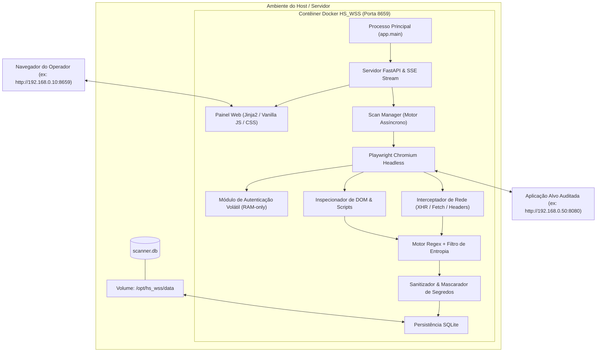

# HS_WSS — HS Tech Web Secret Scanner

<div align="center">


<br/>

**Scanner dinâmico DevSecOps para descoberta e triagem de credenciais, chaves de API e segredos expostos em aplicações web modernas (SPAs, APIs REST e DOM renderizado) com Painel Web Efêmero atrelado ao terminal.**

[Recursos](#-principais-recursos) • [Arquitetura](#-arquitetura-do-sistema) • [Início Rápido](#-como-executar) • [Interface](#-interface-web-3-guias) • [Segurança](#-segurança-e-privacidade-por-design) • [Documentação](#-documentação-completa)

</div>

---

## 💡 Visão Geral

O **HS_WSS (HS Tech Web Secret Scanner)** foi desenvolvido para resolver um problema crítico em auditorias de segurança e pipelines DevSecOps: **a identificação de credenciais e chaves expostas em tempo de execução**. 

Ao contrário de scanners estáticos convencionais que analisam apenas arquivos de código-fonte, o HS_WSS executa uma instância do **Chromium Headless via Playwright**, permitindo:
1. Renderizar completamente Single Page Applications (React, Vue, Angular, Next.js).
2. Interceptar tráfego de rede ativo (requisições e respostas `XHR`/`Fetch` e cabeçalhos `Authorization`).
3. Executar autenticação temporária em áreas restritas utilizando credenciais 100% voláteis em memória RAM.
4. Triar descobertas em tempo real através de um **Painel Web Efêmero**, que é desativado imediatamente ao fechar a sessão do terminal (`Ctrl+C`).

---

## 🌟 Principais Recursos

- 🚀 **Rastreamento Dinâmico de SPAs:** Navega recursivamente por rotas internas, executa scripts JavaScript do lado do cliente e aguarda estabilização de rede (`networkidle`).
- 🌐 **Interceptação Profunda de Rede:** Captura cabeçalhos de autenticação (`Authorization: Bearer`, `X-Api-Key`), requisições POST/GET e respostas de endpoints JSON e scripts dinâmicos.
- 🔐 **Autenticação no Alvo com Memória Volátil (RAM-only):** Permite testar sistemas restritos com login automatizado. As credenciais nunca são gravadas em disco, banco de dados ou logs, sendo destruídas da memória imediatamente após a tentativa.
- ⚠️ **Detecção e Alerta de Falha de Login:** Identifica proativamente formulários ausentes ou recusa de credenciais pelo site auditado, alertando o operador em tempo real na interface e no histórico.
- 🧠 **Motor Híbrido: Regex + Entropia de Shannon:** Regras para os principais provedores de nuvem (AWS, GCP, GitHub, Slack, Stripe, JWT, DB URIs) combinadas com cálculo estatístico de entropia para eliminar falsos positivos.
- 👁️ **Revelação Segura de Segredos On-Screen:** Por padrão, todos os valores são mascarados preservando apenas os primeiros e últimos 4 caracteres (ex: `[PREFIXO]****************[SUFIXO]`). O operador pode revelar o segredo completo temporariamente na tela através do botão `👁️ Revelar`, sem persistência em texto claro.
- 🎛️ **Interface Web Minimalista (3 Guias Especializadas):**
  - **Guia 1 (Varredura):** Configuração de alvo, profundidade, páginas e autenticação opcional.
  - **Guia 2 (Status da varredura):** Monitoramento ao vivo, telemetria (KPIs), rota atual e tabela em tempo real via Server-Sent Events (SSE).
  - **Guia 3 (Histórico):** Histórico de auditorias com visualização inline dos segredos, exportação JSON/CSV e limpeza sob demanda.
- 🛡️ **Segurança de Execução (Terminal-bound):** O painel web escuta na porta configurada e encerra imediatamente quando o processo do terminal é finalizado, prevenindo superfícies de ataque residuais.
- 🔒 **Pipeline DevSecOps Automatizado:** Verificações bloqueantes no GitHub Actions com **Semgrep** (SAST), **Gitleaks** (Secrets), **Checkov** (IaC), **Trivy** (SCA) e geração de SBOM **CycloneDX**.

---

## 📐 Arquitetura do Sistema



---

## 📁 Estrutura do Repositório

```text
/opt/hs_wss/
├── .env.example                  # Modelo sanitizado de variáveis de ambiente
├── .env                          # Configurações ativas da aplicação (ignorado no git)
├── .gitignore                    # Regras de exclusão de arquivos e bases locais
├── .dockerignore                 # Otimização de contexto do build Docker
├── Dockerfile                    # Imagem segura (non-root, healthcheck, Playwright)
├── docker-compose.yml            # Orquestração da execução efêmera atrelada ao terminal
├── requirements.txt              # Dependências Python estritamente pinadas
├── README.md                     # Documentação principal
├── .github/
│   └── workflows/
│       └── security.yml          # Pipeline CI/CD (SAST, Secret, IaC, SCA, SBOM)
├── docs/
│   ├── architecture.md           # Arquitetura detalhada, fluxo de dados e modelo de ameaças
│   ├── usage.md                  # Guia passo a passo de operação e procedimentos
│   └── regex_rules.md            # Catálogo de regras Regex e guia de customização
├── app/
│   ├── main.py                   # Ponto de entrada FastAPI e ciclo de vida lifespan
│   ├── config.py                 # Validação de variáveis de ambiente com Pydantic
│   ├── database.py               # Sessões SQLAlchemy e controle de inicialização do SQLite
│   ├── models.py                 # Modelos ORM (Scan, Finding, VisitedURL)
│   ├── scanner/
│   │   ├── rules.py              # Regras Regex, cálculo de entropia e mascaramento
│   │   ├── crawler.py            # Rastreador Playwright, SSRF guard e login volátil
│   │   └── engine.py             # Gerenciamento de tarefas assíncronas e broadcasting SSE
│   ├── api/
│   │   ├── routes.py             # Rotas REST e endpoints de exportação JSON/CSV
│   │   └── schemas.py            # Schemas de validação de requisições e respostas
│   ├── static/
│   │   ├── css/
│   │   │   └── style.css         # Estilização autossuficiente (sem dependência de CDNs)
│   │   └── js/
│   │       └── app.js            # Aplicação SPA segura (sem innerHTML, safe DOM API)
│   └── templates/
│       ├── base.html             # Layout base com headers de segurança e CSP
│       └── index.html            # Interface de 3 guias (Varredura, Status, Histórico)
└── data/
    └── .gitkeep                  # Diretório de persistência montado via volume
```

---

## 🚀 Como Executar

### 1. Clonar e Configurar o Ambiente

```bash
cd /opt/hs_wss
cp .env.example .env
```

Ajuste as configurações no `.env` conforme necessário:

```env
HOST=0.0.0.0
PORT=8659
DB_PATH=/opt/hs_wss/data/scanner.db
PURGE_ON_STARTUP=true
MAX_CRAWL_DEPTH=3
MAX_CRAWL_PAGES=50
PAGE_TIMEOUT_MS=20000
HEADLESS=true
```

### 2. Inicialização Efêmera (Docker Compose)

Execute o comando **sem** a flag `-d` para garantir que o processo permaneça atrelado ao terminal:

```bash
docker compose up --build
```

O terminal exibirá a inicialização e o banner de status:

```text
================================================================================
  _    _  _____ __          __ _____  _____ 
 | |  | |/ ____|\ \        / // ____|/ ____|
 | |__| | (___   \ \  /\  / /| (___ | (___  
 |  __  |\___ \   \ \/  \/ /  \___ \ \___ \ 
 | |  | |____) |   \  /\  /   ____) |____) |
 |_|  |_|_____/     \/  \/   |_____/|_____/ 
                                            
 HS Tech Web Secret Scanner & Dynamic Interceptor
================================================================================
 [*] Modo de Execução: Efêmero atrelado ao terminal (Terminal-bound)
 [*] Binding Host:     0.0.0.0
 [*] Porta do Painel:  8659
 [*] Persistência:     /opt/hs_wss/data/scanner.db
 [*] Engine:           Playwright Headless + Regex Scanner
--------------------------------------------------------------------------------
 [>>>] Painel Web acessível em: http://0.0.0.0:8659
       (Na rede local, acesse via: http://<IP-DO-SERVIDOR>:8659)
 [!]   Pressione Ctrl+C para encerrar o scanner e desativar o painel web.
================================================================================
```

### 3. Acessar o Painel

Abra no seu navegador:

```text
http://192.168.0.10:8659
```
*(Substitua pelo endereço IP do servidor na rede local).*

### 4. Encerramento Seguro

Quando a auditoria for finalizada, pressione `Ctrl+C` no terminal. O contêiner e o servidor FastAPI serão desligados imediatamente, garantindo que o painel web não permaneça exposto no servidor.

---

## 🖥️ Interface Web (3 Guias Especializadas)

A interface foi projetada com foco em clareza, usabilidade e leitura rápida:

1. **Guia 1 — Varredura:** 
   - Campo para inserção da URL alvo (ex: `http://192.168.0.50:8080`).
   - Controles de profundidade de links e limite de páginas a visitar.
   - Opção de autenticação com campos de usuário/senha voláteis e URL personalizada de login.
   - Botão **Iniciar Varredura** com redirecionamento automático para a esteira em tempo real.

2. **Guia 2 — Status da varredura:**
   - Indicador de status ao vivo (`Executando`, `Concluído`, `Interrompido`).
   - Alertas visuais dinâmicos para login (aviso vermelho caso as credenciais sejam recusadas; confirmação verde para sessão autenticada).
   - Rota atual sendo auditada em tempo real pelo Playwright.
   - Métricas (KPIs) de páginas analisadas, segredos críticos, altos e total.
   - Tabela de segredos encontrados via SSE com botão **`👁️ Revelar`** e modal de trecho de código (**`🔍 Detalhes`**).
   - Botões para interromper a execução e exportar os dados em JSON ou CSV.

3. **Guia 3 — Histórico:**
   - Lista completa de execuções anteriores registradas no SQLite.
   - Badges visuais de autenticação na coluna de aplicação (`⚠️ Login Falhou` ou `🔐 Autenticado`).
   - Botão **`👁️ Visualizar`** que abre os detalhes e a lista de segredos inline logo abaixo da tabela selecionada.
   - Botão **`🧹 Limpar Histórico`** para zerar os registros de auditorias anteriores sob demanda.

---

## 🔒 Segurança e Privacidade por Design

| Princípio | Implementação no HS_WSS |
| :--- | :--- |
| **Proteção contra SSRF** | Validação estrita de esquema (`http`/`https`), restrição rígida ao domínio alvo e bloqueio automático de faixas de metadados de nuvem (`169.254.169.254`, `metadata.google.internal`). |
| **Privacidade de Credenciais** | Credenciais informadas para login são manipuladas exclusivamente em memória volátil durante a sessão do crawler e destruídas no bloco `finally`. Nunca são persistidas em disco, banco de dados ou logs. |
| **Proteção contra XSS / Injeção** | Content-Security-Policy (CSP) rigoroso (`script-src 'self'`), templates Jinja2 seguros e manipulação de interface via `textContent` (sem uso de `innerHTML`). |
| **Execução Segura em Contêiner** | Execução sob usuário desprivilegiado (`pwuser`, UID 1000) e diretiva `no-new-privileges:true`. |
| **Autonomia de Ativos** | CSS e ícones totalmente autossuficientes e embarcados, sem dependência de CDNs externas que possam vazar telemetria ou sofrer ataques de supply chain. |

---

## 📚 Documentação Completa

Para aprofundar nos aspectos técnicos, operacionais e de customização:

- 🏛️ [**Arquitetura do Sistema & Modelo de Ameaças**](docs/architecture.md)
- 📖 [**Guia de Uso & Procedimento Operacional**](docs/usage.md)
- 🎯 [**Catálogo de Regras Regex & Entropia**](docs/regex_rules.md)

---

## 📄 Licença

Este projeto é disponibilizado sob a licença [MIT](LICENSE).
