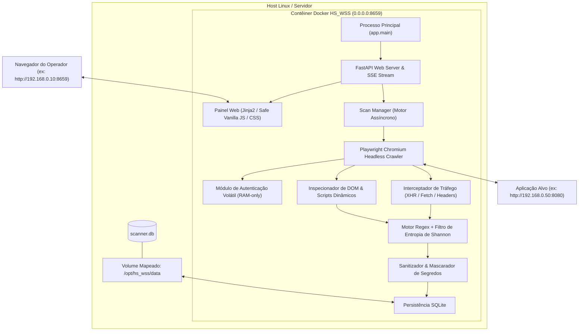
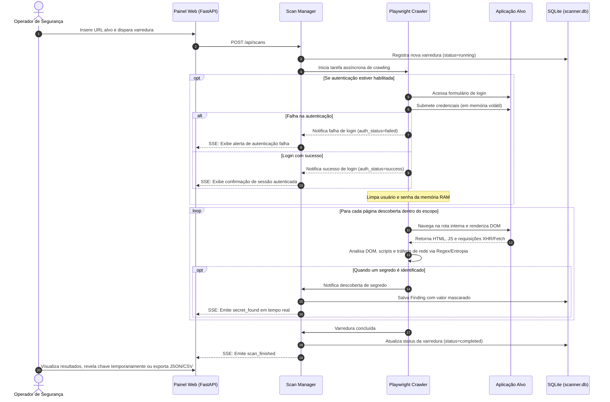

# Arquitetura do Sistema — HS_WSS

O **HS_WSS (HS Tech Web Secret Scanner)** é uma ferramenta de DevSecOps concebida para auditoria dinâmica e identificação automatizada de credenciais, chaves de API e segredos expostos em aplicações web dinâmicas, Single Page Applications (SPAs) e APIs REST.

---

## 1. Visão Geral da Arquitetura

O sistema opera sob o modelo de **execução efêmera atrelada ao terminal (terminal-bound execution)**: o servidor web FastAPI e o motor de varredura Playwright executam em primeiro plano no mesmo processo. Quando o operador encerra a sessão via terminal (`Ctrl+C`), o painel web torna-se imediatamente inacessível, eliminando qualquer superfície de exposição residual de portas na infraestrutura.

---

## 2. Componentes Principais

### 2.1 Servidor Web & Painel Efêmero (`app/main.py` e `app/api/`)
* **Framework:** FastAPI sobre ASGI Uvicorn.
* **Binding de Rede:** `0.0.0.0` com porta configurável via `.env` (padrão: `8659`).
* **Segurança de Cabeçalhos HTTP:**
  * `Content-Security-Policy (CSP)` estrito: restringe scripts, imagens e conexões exclusivamente a `'self'` e dados inline necessários.
  * `X-Frame-Options: SAMEORIGIN` (prevenção contra Clickjacking).
  * `X-Content-Type-Options: nosniff` (mitigação contra MIME-type sniffing).
  * `Permissions-Policy: geolocation=(), microphone=(), camera=()`.
* **Streaming em Tempo Real (SSE):** O endpoint `/api/stream` transmite eventos via Server-Sent Events (`scan_started`, `scan_progress`, `secret_found`, `scan_finished`), atualizando as métricas da interface instantaneamente sem polling HTTP contínuo.
* **Arquitetura da Interface:** Organizada em 3 guias lógicas (*Varredura*, *Status da varredura*, *Histórico*) com manipulação direta e segura do DOM (Safe DOM APIs via `textContent`, sem o uso de `innerHTML`).

### 2.2 Motor de Rastreamento Dinâmico (`app/scanner/crawler.py`)
* **Engine:** Playwright Python API operando com Chromium Headless.
* **Renderização Completa de SPAs:** Navega em aplicações modernas (React, Vue, Angular, Svelte, Next.js), aguardando eventos de ciclo de vida (`domcontentloaded`, `networkidle`).
* **Interceptação de Tráfego de Rede:**
  * Escuta requisições de saída (`page.on('request')`), inspecionando cabeçalhos de autorização (`Authorization: Bearer`, `X-Api-Key`, `Cookie`) e corpos de dados.
  * Escuta respostas de rede (`page.on('response')`), lendo dinamicamente payloads JSON de APIs e scripts carregados em tempo de execução.
* **Controle de Escopo e Proteção de Domínio:**
  * Normalização e desfragmentação estrita de URLs para evitar loops de crawling.
  * O crawler segue exclusivamente links e recursos pertencentes ao mesmo domínio (`target_domain`) da URL alvo, impedindo a navegação involuntária para sistemas externos.
  * Controles de segurança contra SSRF validam esquema de rede e bloqueiam faixas de metadados de nuvem.

### 2.3 Módulo de Autenticação Volátil & Detecção de Falhas
* **Memória Estritamente Volátil (RAM-only):** Quando o operador opta por realizar a auditoria com login, as credenciais informadas residem unicamente em atributos voláteis da instância do crawler.
* **Ciclo de Vida das Credenciais:**
  1. O crawler navega até a URL de login especificada (ou a URL base).
  2. Identifica dinamicamente os seletores de usuário e senha.
  3. Preenche e submete o formulário.
  4. **Destruição Imediata:** No bloco `finally`, as credenciais são sobrescritas para `None` na memória da aplicação, garantindo que nunca sejam salvas em banco de dados, logs ou arquivos temporários.
* **Heurísticas de Detecção de Falha de Login:**
  - Verifica ausência de campos de autenticação no alvo.
  - Intercepta mensagens de erro no DOM (`.alert-error`, `.invalid-feedback`, termos como *“invalid”*, *“incorreto”*, *“recusado”*).
  - Detecta permanência na página de login com o campo de senha ainda visível após a submissão.
  - Dispara avisos explicativos sanitizados para a interface em tempo real (`auth_status = "failed"`).

### 2.4 Motor de Detecção de Segredos (`app/scanner/rules.py`)
* **Regex Engine de Alta Precisão:** Padrões compilados para provedores de nuvem (AWS, GCP, GitHub, Slack, Stripe, JWT, Connection Strings).
* **Filtro de Entropia de Shannon:** Para regras genéricas de tokens, calcula a incerteza de informação da cadeia de caracteres para descartar identificadores CSS, variáveis triviais e sequências repetidas.
* **Mascaramento e Revelação Controlada:**
  - Os valores detectados são mascarados por padrão (ex: `[PREFIXO_4_CHARS]****************[SUFIXO_4_CHARS]`).
  - Snippets de código têm a chave confidencial substituída pelo valor mascarado antes do envio ao frontend.
  - Para validação rápida pelo operador, a interface disponibiliza o recurso de exibição estritamente em tela via botão `👁️ Revelar`, sem persistir o dado sensível em disco.

### 2.5 Camada de Persistência (`app/database.py` e `app/models.py`)
* **Engine:** SQLite3 com SQLAlchemy em modo thread-safe (`check_same_thread: False`).
* **Volume Docker:** O arquivo `/opt/hs_wss/data/scanner.db` persiste o histórico de varreduras entre execuções.
* **Limpeza Configurável de Sessão (`PURGE_ON_STARTUP`):** Permite iniciar cada sessão com um ambiente limpo ou manter o histórico anterior.
* **Migrations Seguras:** Validação de esquema na inicialização (`PRAGMA table_info`), adicionando colunas sem perda de dados existentes.

---

## 3. Fluxo de Execução da Auditoria

---

## 4. Modelo de Ameaças & Controles DevSecOps

| Ameaça / Risco | Impacto | Controles de Segurança Implementados |
| :--- | :--- | :--- |
| **SSRF (Server-Side Request Forgery)** | Acesso indevido a serviços internos ou metadados de provedores cloud. | Validação estrita de esquemas permitidos (`http`, `https`), bloqueio obrigatório de IPs de metadados (`169.254.169.254`, `metadata.google.internal`) e restrição rígida ao domínio do alvo. |
| **Vazamento de Credenciais de Teste** | Exposição de credenciais de login utilizadas durante a auditoria. | Credenciais são mantidas unicamente na memória volátil (RAM) durante a tentativa de login e apagadas no bloco `finally`. Nenhuma credencial é escrita em banco de dados ou logs. |
| **Cross-Site Scripting (XSS)** | Execução de scripts maliciosos no navegador do operador ao renderizar dados auditados. | Implementação de Content-Security-Policy (CSP) estrito e manipulação do DOM exclusivamente através de Safe DOM APIs (`textContent`, `replaceChildren`). |
| **Exposição Residual de Portas** | Manutenção de serviços web abertos permanentemente no servidor. | Arquitetura efêmera atrelada ao terminal: o painel só existe enquanto a sessão CLI estiver em execução. Ao encerrar o terminal (`Ctrl+C`), o painel fecha imediatamente. |
| **Execução com Privilégios Elevados** | Risco de fuga de contêiner ou acesso indevido ao host. | Execução sob usuário não privilegiado (`pwuser`, UID 1000) e uso da flag de segurança `no-new-privileges:true` no Docker. |

---

## 5. Pipeline de CI/CD de Segurança (GitHub Actions)

O repositório é protegido por um workflow de segurança automatizado em `.github/workflows/security.yml`, contendo jobs bloqueantes:

1. **Lint & SAST (Semgrep):** Varredura estática de código-fonte Python para identificação de padrões inseguros de programação e vulnerabilidades OWASP.
2. **Secret Scanning (Gitleaks):** Bloqueio de commits e pull requests que acidentalmente incluam chaves privadas ou tokens reais.
3. **IaC & Container Scanning (Checkov):** Análise de segurança e privilégios no `Dockerfile` e no `docker-compose.yml`.
4. **Dependency Scanning (Trivy):** Análise de dependências (`requirements.txt`) e vulnerabilidades de pacotes de sistema da imagem base.
5. **Software Bill of Materials (CycloneDX SBOM):** Geração e arquivamento automatizado do inventário SBOM a cada novo release.
